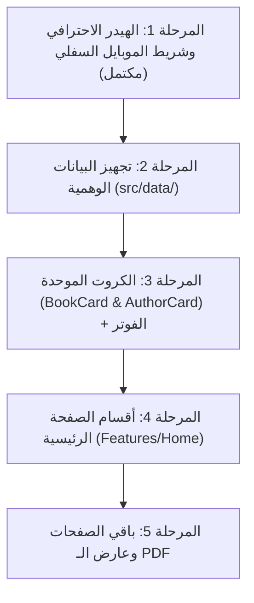

# خطة تطوير مشروع منصة ( قلم ) للمكتبة المسيحية
> وثيقة التخطيط الاستراتيجي والمعماري ومراحل التنفيذ خطوة بخطوة.

---

## 1. هوية ونطاق المشروع (Project Scope)

- **اسم المشروع:** منصة **قلم** للمكتبة المسيحية الإلكترونية.
- **الهدف:** توفير منصة عربية راقية ومبسطة لقراءة وتصفح وحفظ الكتب والأبحاث والمقالات الدينية المسيحية، وتشجيع الأقلام الواعدة.
- **اللغة:** اللغة العربية بالكامل (RTL) مع خط `Almarai`.
- **التقنيات المستخدمة:**
  - **Next.js 16 (App Router)**
  - **React 19**
  - **TypeScript**
  - **Sass (SCSS Modules)**
  - **Lucide React** (أيقونات موحدة وعصرية)
  - **SocialIcons:** المكون المعتمد من `src/components/common/SocialIcons/` لجميع أيقونات التواصل الاجتماعي.

---

## 2. الهوية البصرية ونظام الألوان (Design System)
مستخرجة بدقة من لوجو المشروع، ومحددة بالمتغيرات الثلاثة في `src/styles/global.scss`:
- `--main_color: #C59B4E;` (الذهبي الدافئ والعتيق: للريشة، الإبرازات، النجوم، الشارات، والأزرار الثانوية).
- `--secondary_color: #3D250C;` (البني الداكن الوقور: للأزرار الرئيسية، العناوين، الأيقونات والنصوص).
- `--therd_color: #543314;` (البني الكستنائي الغني: لتدرجات الفوتر واللمسات ذات العمق).

---

## 3. قائمة الصفحات المطلوبة (Site Pages)
النطاق محدد بدقة دون خروج عنه:
1. **الرئيسية (`/`):**
   - الهيرو (Hero Section) مع شعار المنصة والبحث السريع.
   - النبذة التعريفية برؤية قلم.
   - الكتاب المقترح / المميز (Featured Book Slider).
   - شريط التصنيفات السريع (Categories Bar / Slider).
   - أقسام الكتب (الأحدث، مقترح لك اليوم، الأكثر قراءة، جديد وحصري، كتاب اليوم).
   - قسم أشهر المؤلفين (Top Authors).
2. **مكتبتى (`/my-library`):**
   - صفحة الكتب المحفوظة والمفضلة للمستخدم، مع إمكانية الفلترة وتتبع القراءة.
3. **الاقسام (`/categories`):**
   - استعراض شامل للتصنيفات (كتب روحية، تاريخ الكنيسة، دراسات كتابية، مقالات، قصص، إلخ) مع تصفح كتب كل قسم.
4. **المؤلفين (`/authors`):**
   - دليل مؤلفي الكتب المسيحية وسيرهم الذاتية والكتب المنسوبة لكل مؤلف.
5. **تواصل معنا (`/contact`):**
   - نموذج تواصل بسيط، معلومات التواصل مع السوشيال ميديا الموحدة، واستقبال استفسارات واقتراحات القراء والكتّاب.
6. **الحساب والمصادقة (`/login` & `/register`):**
   - واجهة تسجيل دخول وإنشاء حساب أنيقة وبسيطة تتماشى مع الطابع الوقور للمنصة.
7. **قارئ الكتب (`/reader/[bookId]`):**
   - عارض مخصص لملفات PDF بتصميم ورقي/دافئ أنيق ومريح للقراءة (Sepia Theme، تنقل سريع، تكبير، شاشة كاملة، وفهرس).

---

## 4. المكونات المشتركة والثابتة (Shared Reusable Components)

### أ. الهيدر الاحترافي (`src/components/layout/Header`)
- **على الديسكتوب:**
  - شعار قلم والاسم "قَلَم."
  - روابط التنقل الأساسية (الرئيسية | مكتبتى | الاقسام | المؤلفين | تواصل معنا) مع تمييز الصفحة النشطة.
  - شريط بحث مباشر وسريع.
  - زر تسجيل الدخول.
- **على الموبايل (Phone):**
  - شعار قلم "قَلَم."
  - زر أيقونة البحث: عند الضغط يفتح حقل بحث منسدل بانسيابية تحت الهيدر.
  - زر تسجيل الدخول.
  - (تم الاستغناء التام عن قائمة الهمبرجر لأن التنقل يتم عبر شريط التطبيق السفلي `BottomNav`).

### ب. شريط التنقل السفلي للموبايل (`src/components/layout/BottomNav`)
- شريط سفلي ثابت يظهر فقط على الهواتف بتجربة التطبيق الحقيقي:
  - الرئيسية (Home)
  - مكتبتى (Library)
  - الاقسام (Categories)
  - المؤلفين (Authors)
  - حسابي (Account)

### ج. شريط مسار التصفح الموحد (`src/components/common/BreadcrumbBar`)
- شريط مرن وأنيق يوضح مسار المستخدم في الموقع:  
  `الرئيسية > الأقسام > كتب تاريخ الكنيسة` مع فواصل أيقونية دقيقة وروابط نشطة.

### د. الفوتر الأنيق (`src/components/layout/Footer`)
- تصميم دافئ بتدرج لوني عريق.
- نبذة موجزة عن رسالة المنصة.
- روابط سريعة للصفحات والتصنيفات.
- أيقونات التواصل الاجتماعي المستوردة حصراً من `SocialIcons`.
- حقوق النشر الرسمية.

### هـ. كارت الكتاب الموحد (`src/components/common/BookCard`)
- صورة غلاف الكتاب بنسبة أبعاد مدروسة (Book Aspect Ratio) مع ظل كتاب حقيقي.
- تقييم النجوم (Stars Rating) باللون الذهبي `--main_color`.
- عنوان الكتاب واسم المؤلف بوضوح.
- زر الإضافة لمكتبتي (Bookmark/Favorite) بنقرة واحدة وتفاعل بصري.
- زر القراءة السريعة (PDF Reader).
- شارات مميزة (جديد، مقترح، الأكثر قراءة).

### و. كارت المؤلف الموحد (`src/components/common/AuthorCard`)
- صورة المؤلف بإطار دائري مستوحى من الهوية مع لمسة عتيقة.
- اسم المؤلف والبلد / التخصص.
- عدد الكتب المنشورة.
- تفاعل سلس عند التحويم.

### ز. عارض الكتب الاحترافي (`src/components/common/PdfViewer`)
- عارض متكامل لملفات الـ PDF يعتمد إما على PDF.js أو تقنية Canvas/Iframe المخصصة، بواجهة متناسقة مع ألوان المنصة الداكنة والذهبية، وإتاحة وضع القراءة الورقية، التحكم بالصفحات، وتتبع موضع القراءة.

---

## 5. خطوات التنفيذ المرحلية

